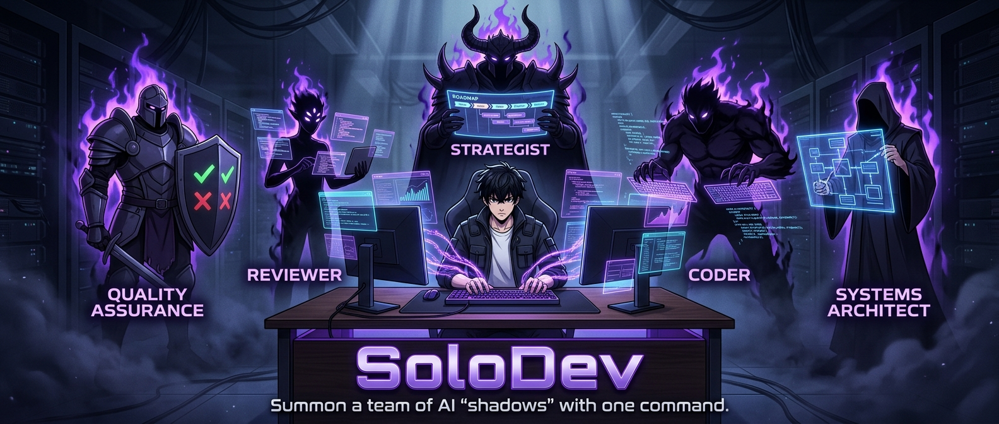
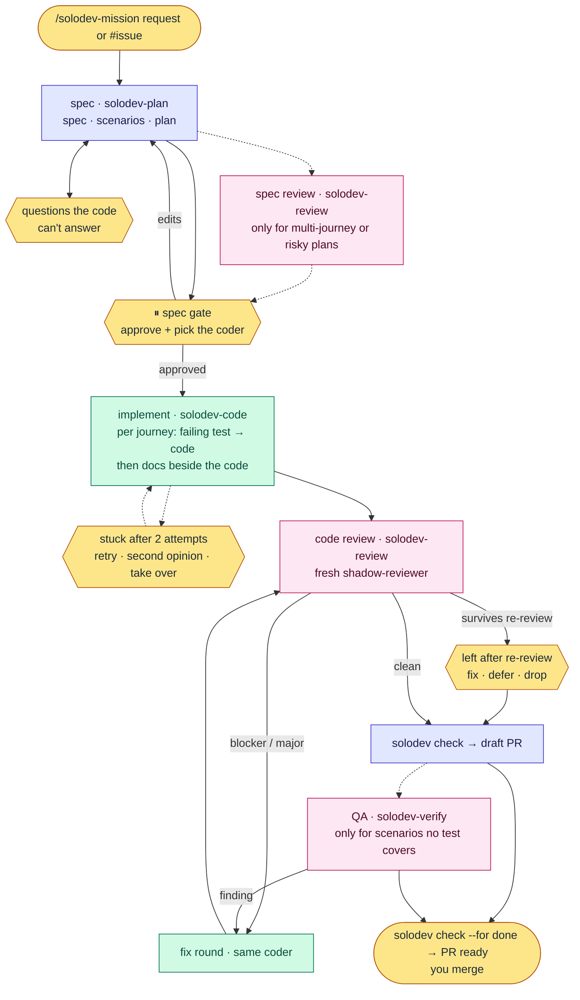

# Solodev

**Spec-driven development for top coding agents.** Describe a feature, approve one spec, and get back a reviewed,
tested, documented pull request, on [Claude Code](https://code.claude.com),
[Codex](https://developers.openai.com/codex), or [Cursor](https://cursor.com).

solodev installs a set of short role skills, two agents that play them (the shadows), and a small `solodev` CLI that
checks the work. Your main session writes the spec and plan with you; one coder writes the code, test first; a reviewer
with a fresh context checks it. You approve the spec at the gate and merge the PR.

```text
/solodev-mission Add CSV export to the accounts page
```

## The name

solodev takes its name from the anime _Solo Leveling_, where one hunter commands an army of shadows. You are the solo
dev, and your army is a group of shadows: the strategist, the architect, the coder, the reviewer and QA.
`/solodev-mission` sends them commands (`solodev-plan`, `solodev-code`, `solodev-review`, `solodev-verify`), and they
bring back a reviewed, tested pull request. The strategist answers to `/solodev-roadmap`.

## Why

A single agent asked to "build feature X" guesses at scope, writes tests that pass by construction, reviews its own
work, and loses track when the context runs out. Top models don't need a heavy harness to avoid that; they need a few
things they can't give themselves:

- **One approved spec.** Requirements and `@S<n>` acceptance scenarios, plus a plan of at most three journeys (one test
  file each), approved by you before any code.
- **Failing test first, proven.** `solodev check` runs each journey test against the code before the feature (it must
  fail) and against the branch (it must pass), and flags a test that was skipped, deleted or loosened.
- **Independent eyes.** The agent that wrote the code never signs off on it. Pick a coder on another tool and every PR
  also gets a review from a different model family.
- **Nothing extra in your repo.** A feature's spec, plan, reports and approval live in one folder outside it,
  `~/.agents/solodev/<owner>/<repo>/<slug>/`. Your branch holds only code, tests and docs, and any session can resume
  with `solodev status`.
- **Short instructions, loaded when needed.** Each role is a skill of a few dozen lines; detail sits in references read
  only when a step needs it.
- **You stay in charge.** solodev opens the PR and marks it ready. It never merges.

## When to use `/solodev-mission`

Use it for:

- New features that touch multiple files
- Features requiring architectural decisions
- Complex integrations with existing code
- Features where requirements are somewhat unclear

Don't use it for:

- Single-line bug fixes
- Trivial changes
- Well-defined, simple tasks

For those, use your tool's plan mode (`/plan`), or just ask for the change. `/solodev-mission` says so when a request
looks like one of them, and continues if you still want the full run.

## Quick start

### 1. Install

From the root of the repository you want to work on:

```bash
npx -y github:luisintosh/solodev
```

The installer asks for a **scope** (this repo or `$HOME`) and the **hosts** to install for (Claude Code, Codex, Cursor).
It downloads the release payload from GitHub Releases, verifies its sha256, and shows the file plan before applying it.
Pin a release with `#vX.Y.Z`. Re-running is idempotent, and files removed upstream are cleaned up.

Flags: `--dry-run`, `--doctor`, `--yes`. For CI or scripts, use `INSTALL_SCOPE=project|global` and
`INSTALL_TARGET=all|claude,codex,cursor`.

**Requirements**, with the macOS install command (most use [Homebrew](https://brew.sh)):

- [Node.js](https://nodejs.org) 20+, to run the installer and the `solodev` CLI: `brew install node`
- [Git](https://git-scm.com): `xcode-select --install`
- [GitHub CLI](https://cli.github.com) (`gh`), to open the PR, or another forge connected through an MCP server, skill
  or CLI: `brew install gh && gh auth login`
- At least one coding tool, logged in:
  - [Claude Code](https://code.claude.com): `curl -fsSL https://claude.ai/install.sh | bash`
  - [Codex](https://developers.openai.com/codex): `curl -fsSL https://chatgpt.com/codex/install.sh | sh`
  - [Cursor CLI](https://cursor.com/cli): `curl https://cursor.com/install -fsS | bash`

Optional:

- [Orca](https://www.onorca.dev), for a coder on another tool:
  `brew install --cask stablyai/orca/orca && orca skills install --skill orchestration`
- [agent-browser](https://github.com/vercel-labs/agent-browser), for checking UI scenarios no test covers:
  `npm install -g agent-browser && agent-browser install`
- [rtk](https://github.com/rtk-ai/rtk), to trim noisy command output for agents: `brew install rtk`

### 2. Map the repo (optional, once)

```text
/solodev-scout
```

This writes a short `AGENTS.md` and `docs/ARCHITECTURE.md` if they are missing. `AGENTS.md` holds a `## Commands` list
(install, dev, build, test, test_file, lint, typecheck; `n/a` when the repo has none) that the `solodev` CLI reads, plus
only the constraints the code doesn't show. Without it, each `/solodev-mission` run finds the commands itself and
`solodev check` skips the ones AGENTS.md doesn't list.

### 3. Plan a whole product (optional)

Run `/solodev-roadmap` and describe the idea. It explores the codebase, turns the idea into a measurable goal, agrees a
data model with you, and drafts a roadmap with dependency-ordered waves and one work item per feature, each reviewed by
an adversarial subagent. It files the roadmap as a GitHub epic with one issue per feature, wired with `Blocked by #N`;
the tracker is the source of truth. Without one, the drafts in `~/.agents/solodev/<repo>/roadmaps/<slug>/` are the
record. Nothing is written to your repo.

### 4. Build a feature with `/solodev-mission`

```text
/solodev-mission Add CSV export to the accounts page
/solodev-mission #42
```

Run it on your most capable session model. `/solodev-mission` creates `feat/<slug>`, writes the spec and plan with you,
stops at the gate, and finishes with a ready PR. At the gate you also pick who writes the code: the tool you're in, or
another one through Orca, which saves your usage on this one. To resume an interrupted run, ask it to continue.

The roles also work on their own: `/solodev-review` reviews any branch, and `/solodev-plan` writes a spec without
running the feature.

## How it works



Blue runs in your main session, green is the one coder, pink is a fresh-context reviewer, yellow is you. Dotted steps
run only when they add something.

| Step          | Who                                  | Leaves when                                              |
| ------------- | ------------------------------------ | -------------------------------------------------------- |
| 1 start       | the commander (`/solodev-mission`)   | `solodev probe` done, branch `feat/<slug>` cut           |
| 2 spec        | `solodev-plan`, in your main session | `spec.md` and `plan.md` written, your questions answered |
| 3 spec review | `solodev-review`, only when needed   | the commander applied the findings it agrees with        |
| 4 ⏸ gate      | you                                  | `solodev approve` recorded                               |
| 5 implement   | `solodev-code`, the one writer       | `solodev check --for implement` passes                   |
| 6 code review | `solodev-review`, fresh              | `review.md` has no open blocker or major                 |
| 7 PR          | the commander                        | `solodev check --for pr` passes, draft PR open           |
| 8 QA          | `solodev-verify`, if needed          | uncovered scenarios have verdicts                        |
| 9 finish      | the commander                        | `solodev check --for done` passes, PR marked ready       |

Spec review runs when the plan has more than one journey or touches a dependency, a public API, a schema, auth or
security. The verifier runs only for scenarios no journey test covers, such as a UI path it checks with
[agent-browser](https://github.com/vercel-labs/agent-browser); one it can't automate comes to you to check or waive.
Budgets: two attempts per journey (a failing test or build command at the PR step gets a fix round from the same
budget), one review fix round and one re-review, two QA cycles; a spent budget asks you instead of thrashing.

You're asked only at the spec questions, the gate, findings left after the re-review, a shadow's question or blocker, a
QA scenario that needs a person, a spent budget, a failed Orca worker, and the ready PR. The draft PR carries what a
reviewer needs from the spec and plan, and its footer links the decisions agreed on the ticket. At the finish its
`## Follow-ups` section lists what was left open: deferred findings, open minors and waived scenarios, each with why.
The finish card repeats them as tickets ready to paste.

### The `solodev` CLI

Installed at `.agents/solodev/solodev-cli.mjs`. It holds no state and commits nothing: everything is worked out from git
and the feature folder.

```text
solodev probe                          coding tools, models, Orca, gh, the AGENTS.md commands (JSON)
solodev status [<slug>]                where a feature stands and what comes next
solodev approve <slug>                 record the gate: a line in progress.md with the spec's hash
solodev check <slug> [--for implement|pr|done]   the checks that gate the next step
solodev help [<command>]               what each command does
```

| Check | Proves                                                                                                      |
| ----- | ----------------------------------------------------------------------------------------------------------- |
| C1    | typecheck, lint, test and build from the AGENTS.md commands pass; unlisted ones are skipped                 |
| C2    | every `@S<n>` in the spec is claimed by a journey or listed as uncovered; each journey's test file exists   |
| C3    | each journey test fails against the code before the feature and passes now                                  |
| C4    | no test was skipped, deleted or lost assertions: journey tests since first committed, others since the base |
| C5    | the spec and plan are approved as they stand, and no code was committed before the approval                 |
| C6    | nothing is left uncommitted in the repo (a reviewer or verifier touches only its report)                    |
| C7    | `review.md` has no open blocker or major                                                                    |
| C8    | every uncovered scenario has a `pass` verdict in `qa.md`, or one you `waived`                               |
| C9    | every env var the code reads since the base is named in a README, `docs/` or `.env.example`                 |

## Models

`src/catalog.yaml` pins one model per profile and host. `think` plans and reviews; `implement` writes code and docs.

| profile     | Claude Code                      | Codex              | Cursor                        |
| ----------- | -------------------------------- | ------------------ | ----------------------------- |
| `think`     | `claude-opus-5-5[effort=medium]` | `gpt-6-astra[max]` | `gemini-4-argon[effort=high]` |
| `implement` | `claude-sonnet-5-5[effort=high]` | `gpt-6.1-sol[max]` | `grok-4.7[effort=high]`       |

| shadow            | profile     |
| ----------------- | ----------- |
| `shadow-coder`    | `implement` |
| `shadow-reviewer` | `think`     |

The commander is your session. On Claude Code the `/solodev-mission` skill switches to the `think` model while it runs;
on Codex and Cursor, start the session on the `think` model yourself. CI checks both tables against the catalog.

### A coder on another tool (Orca)

With [Orca](https://github.com/stablyai/orca) running and its `orchestration` skill installed, the gate offers a coder
on another tool you're logged in to, for example Codex coding while Claude Code commands. Orca starts it as a supervised
worker in its own terminal, so you can watch it. Set personal defaults in `~/.agents/solodev/solodev-conf.yaml`:

```yaml
writer: ask # or claude | codex | cursor
dispatch: auto # orca: run every shadow as an Orca worker, even on the home tool
```

## Directory overview

### Where feature state lives

Outside every repo, whatever the install scope (`SOLODEV_STATE` overrides the root):

```text
~/.agents/solodev/<owner>/<repo>/   origin's path, or the checkout's folder name without an origin
  <feature>/
    spec.md                     what and why, with @S<n> acceptance scenarios
    plan.md                     approach and journeys (one test file each)
    progress.md                 the request verbatim, decisions, attempts, and the approval line
    review.md                   review findings and their status (written even when clean)
    qa.md                       verdicts for scenarios no test covers (pass, fail, manual, waived)
    briefs/                     briefs and replies for the shadows
```

The PR body carries the scenarios and journeys, since the spec isn't on the branch.

### What solodev adds to your repo

Only the feature's code, tests and the docs beside them, plus what you ask for:

```text
AGENTS.md  docs/ARCHITECTURE.md   optional, from /solodev-scout
.agents/  .claude/  .cursor/  .codex/   a project-scope install only; a global install puts these under $HOME
```

### This repository

```text
src/
  catalog.yaml          models per host and profile, skills, shadows   ← source of truth
  prompts/skills/       role skills and their references               ← source of truth
  prompts/agents/       the two shadow shells
  prompts/fragments/    shared includes
  cli/                  the solodev CLI
tools/                  transpile, build, install, hygiene check
evals/                  trigger, stage and outcome evals
test/                   e2e install script, fixture repo
bin/install.js          generated installer that npx/bunx run (tracked, never hand-edited)
dist/                   generated install payload (untracked; shipped in each GitHub Release)
```

Prompts are written once and transpiled into each host's format by `pnpm run build`. See
[CONTRIBUTING.md](CONTRIBUTING.md) for the build, check, and release workflow.

## Safety notes

- solodev never merges its own PR. That rule lives in the prompts, so use branch protection as your hard backstop.
- `solodev approve` refuses to record the gate while anything is staged, and `solodev check` fails a branch that
  committed code before the approval or whose spec changed since.

## OpenCode

OpenCode and open-weight models are no longer supported. Pin the last release that ships them,
`npx -y github:luisintosh/solodev#v2.1.1`. Re-running a current installer over an old install removes the OpenCode files
it wrote (only those listed in `.opencode/.harness-manifest`).
