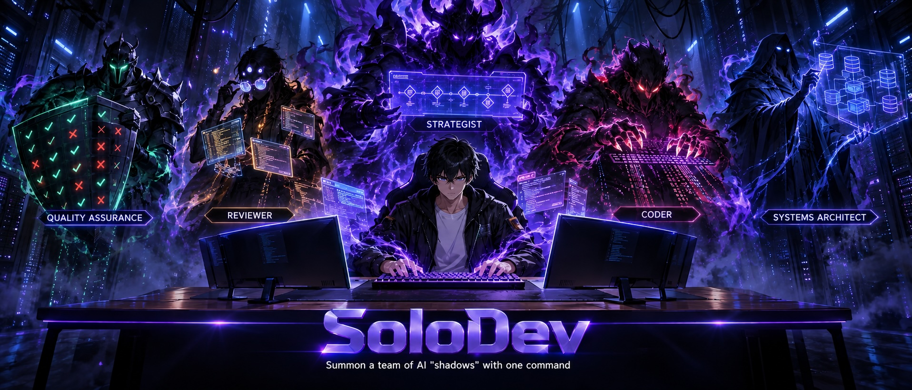
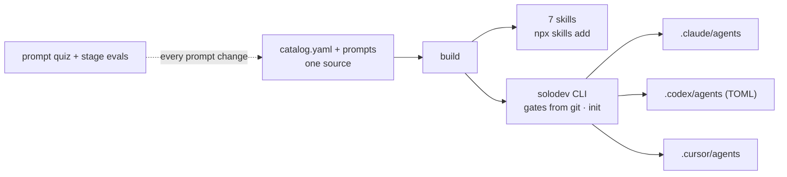

# Solodev

**Ship features with an AI team, not a single agent.** Describe a feature, approve one spec, and get back a reviewed,
tested, documented pull request, on [Claude Code](https://code.claude.com), [Codex](https://developers.openai.com/codex)
or [Cursor](https://cursor.com).

[](https://code.claude.com)
[](https://developers.openai.com/codex)
[](https://cursor.com)
[](LICENSE)

```bash
npx skills add luisintosh/solodev          # -g for every repo
```

Then, once in each coding tool: `/mission init`, start a new session, and:

```text
/mission Add CSV export to the accounts page
```

> I built solodev for my own work; it's the workflow I use every day to ship features with AI agents. —
> [Luis Mendieta](https://github.com/luisintosh)

## Why

Ask one agent to "build feature X" and it guesses at the scope, writes tests that pass by construction, reviews its own
work, and loses the thread when its context fills up. solodev gives top models what they can't give themselves:

|                                               | One agent | Plan mode (`/plan`) | solodev                                       |
| --------------------------------------------- | --------- | ------------------- | --------------------------------------------- |
| Spec you approve before code                  | no        | a plan              | requirements + acceptance scenarios + plan    |
| Tests checked to fail first                   | no        | no                  | yes, by the reviewer, on the old and new code |
| Review by an agent that didn't write the code | no        | no                  | yes, fresh context, by lens                   |
| Machine-checked gates                         | no        | no                  | yes, the `solodev` CLI reads git              |
| Ends in                                       | a diff    | a diff              | a ready PR you merge                          |

## How it works

You'll mostly type three skills: `/mission` ships one feature, `/strategy` plans the features, and `/gen-docs` maps a
repo once.

### `/mission`

`/mission` is the commander. It writes the spec with you, then hands the work to two **shadows**, subagents with their
own models and fresh context: one coder and one reviewer. You can read them first in `skills/mission/shadows/<tool>/`;
`init` copies them into the tool's agents folder (`.claude/agents/`, `.codex/agents/`, `.cursor/agents/`), adding only a
hash line that lets it spot your edits.

1. **Spec.** Requirements, acceptance scenarios tagged `@S1`, `@S2`…, and a plan of at most three **journeys**: one test
   file each, proving a group of scenarios.
2. **Gate.** You approve the spec. No code exists before that, and `solodev check` fails a branch that has some.
3. **Implement.** The coder writes the journey tests, then the code and the docs beside it.
4. **Review.** A reviewer runs each journey test on the old code (it must fail) and the new (it must pass), and reads
   the diff through **lenses**: evidence, contract, correctness, security, design, UI. A large or sensitive change
   (auth, payments, migrations, a public API) gets one reviewer per lens, in parallel. Blockers and majors go back to
   the coder once.
5. **PR.** A draft PR, QA for any scenario no test covers, then the PR is marked ready. You merge.

Every step has a budget (two implement attempts, one fix round, one re-review); a spent budget stops and asks you. With
[Orca](https://github.com/stablyai/orca), the coder can run on another tool, so each PR is also reviewed by a different
model family.

### `/strategy`

Turns a raw idea into a measurable goal, the chosen approach, an agreed data model and a feature roadmap sequenced in
waves. It explores the code to answer its own questions before asking you, and red-teams the plan before you see it.
With your yes, it files the roadmap in your tracker as an epic with one ticket per feature; without a tracker, the
drafts stay in `~/.agents/solodev/<owner>/<repo>/roadmaps/<slug>/`. It only plans: each feature then runs through
`/mission <ticket>`.

### `/gen-docs`

Run it yourself, once per repo. It writes a short `AGENTS.md` (the project's commands, confirmed against its manifests
and scripts, plus constraints the code doesn't show) and `docs/ARCHITECTURE.md` (the module map, how data flows, key
decisions, how tests are organized), so every agent and every `/mission` run starts from facts instead of rediscovering
the repo. It creates only what's missing and commits nothing; `/mission init` suggests it when the repo has no
`AGENTS.md`.

### Other skills

| Skill                            | Role                                              |
| -------------------------------- | ------------------------------------------------- |
| `/solodev-plan`                  | writes a spec on its own                          |
| `/solodev-review`                | reviews a spec or any branch                      |
| `solodev-code`, `solodev-verify` | the coder's and QA's roles, started by `/mission` |

## Models

| profile     | Claude Code                      | Codex              | Cursor                        |
| ----------- | -------------------------------- | ------------------ | ----------------------------- |
| `think`     | `claude-opus-5-5[effort=medium]` | `gpt-6-astra[max]` | `gemini-4-argon[effort=high]` |
| `implement` | `claude-sonnet-5-5[effort=high]` | `gpt-6.1-sol[max]` | `grok-4.7[effort=high]`       |

| shadow            | profile     |
| ----------------- | ----------- |
| `shadow-coder`    | `implement` |
| `shadow-reviewer` | `think`     |

Start your session on the `think` model; it plans and reviews, and the cheaper `implement` model writes the code.

## How it's built



- **One source, three tools.** Roles are written once and compiled to each tool's native format, models pinned in one
  catalog.
- **Rules that code can check are code.** "No code before approval" and "every scenario is claimed" are CLI checks over
  git, with unit tests; prompts keep only what needs judgment.
- **Prompts are tested like software.** A quiz of 77 decision scenarios and 40 routing queries runs after every prompt
  change (latest run: 77/77 scenarios, 40/40 routing); it caught, for example, that tools load subagents only at
  startup, so a run that installs them mid-session now stops for a restart. Stage evals run the real workflow headless,
  with real subagents, graded by scripts on what reached git.
- **Lean.** Each skill has a line budget enforced in CI, detail loads only when a step needs it, and a feature's stage
  is derived from git and its folder, with no state machine.

Source, evals and build: the [`develop`](https://github.com/luisintosh/solodev/tree/develop) branch.

## FAQ

**What lands in my repo?** Only the feature's code, tests and docs, plus the installed skills and subagents for a
project install. The spec and reports live in `~/.agents/solodev/<owner>/<repo>/<feature>/`; the PR carries the
scenarios.

**Do I need GitHub?** No. Any forge or tracker your tool can reach works (`gh`, `glab`, or an MCP server for GitLab,
Jira, Linear…); without one, it asks you.

**How do I resume?** Ask `/mission` to continue. Any session can, since state lives in git and the feature folder.

**Can it merge or push to main?** No. It opens the PR and marks it ready; use branch protection as the backstop.

**Upgrading from v6?** v7 renamed `/solodev-mission` to `/mission`, `/solodev-roadmap` to `/strategy` and
`/solodev-scout` to `/gen-docs`. `npx skills update` doesn't install renamed skills, so add them again, remove the old
names, then run `/mission init` once in each coding tool to refresh the shadows:

```bash
npx skills add luisintosh/solodev
npx skills remove solodev-mission solodev-roadmap solodev-scout
```

Add `-g` to both if you installed globally. Feature folders stay where they are.

**Coming from the old installer (v5 and earlier)?** Install as above and let `/mission init` use `--force` once per
tool. Feature folders stay where they are.

**Requirements:** Node.js 20+, Git, and one coding tool you're logged in to. Optional: a browser tool for UI checks,
such as your coding tool's built-in browser, Chrome DevTools MCP or
[agent-browser](https://github.com/vercel-labs/agent-browser); [rtk](https://github.com/rtk-ai/rtk) for quieter command
output.

---

The name comes from _Solo Leveling_, where one hunter commands an army of shadows. Licensed under Apache 2.0.
