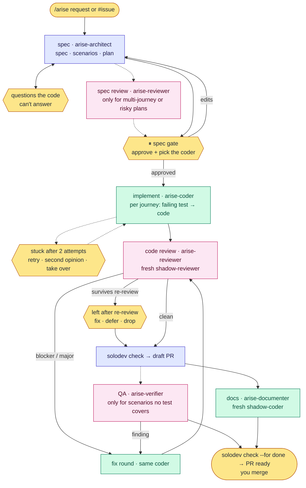

# Solodev

**Spec-driven development for top coding agents.** Describe a feature, approve one spec, and get back a reviewed,
tested, documented pull request, on [Claude Code](https://code.claude.com),
[Codex](https://developers.openai.com/codex), or [Cursor](https://cursor.com).

solodev installs a set of short role skills, two agents that play them (the shadows), and a small `solodev` CLI that
checks the work. Your main session writes the spec and plan with you; one coder writes the code, test first; a reviewer
with a fresh context checks it. You approve the spec at the gate and merge the PR.

```text
/arise Add CSV export to the accounts page
```

## The name

solodev takes its name from the anime _Solo Leveling_, where one hunter commands an army of shadows. You are the solo
dev: `/arise` summons the shadows, each playing one role (`arise-coder`, `arise-reviewer`, …), and they bring back a
reviewed, tested pull request.

## Why

A single agent asked to "build feature X" guesses at scope, writes tests that pass by construction, reviews its own
work, and loses track when the context runs out. Top models don't need a heavy harness to avoid that; they need a few
things they can't give themselves:

- **One approved spec.** Requirements and `@S<n>` acceptance scenarios, plus a plan of at most three journeys (one test
  file each), approved by you before any code.
- **Failing test first, proven.** `solodev check` runs each journey test against the code as it was at the gate (it must
  fail) and against the branch (it must pass), and flags a test that was skipped, deleted or loosened.
- **Independent eyes.** The agent that wrote the code never signs off on it. Pick a coder on another tool and every PR
  also gets a review from a different model family.
- **Git is the state.** One approval commit and a few files in `docs/feats/<slug>/` say where a feature stands, so any
  session can resume with `solodev status`.
- **Short instructions, loaded when needed.** Each role is a skill of a few dozen lines; detail sits in references read
  only when a step needs it.
- **You stay in charge.** solodev opens the PR and marks it ready. It never merges.

## When to use `/arise`

Use it for:

- New features that touch multiple files
- Features requiring architectural decisions
- Complex integrations with existing code
- Features where requirements are somewhat unclear

Don't use it for:

- Single-line bug fixes
- Trivial changes
- Well-defined, simple tasks

For those, use your tool's plan mode (`/plan`), or just ask for the change. `/arise` says so when a request looks like
one of them, and continues if you still want the full run.

## Quick start

### 1. Install

From the root of the repository you want to work on:

```bash
npx -y github:luisintosh/solodev
```

The installer asks for a **scope** (this repo or `$HOME`) and the **hosts** to install for (Claude Code, Codex, Cursor).
It shows the file plan before applying it. Pin a release with `#v2.0.0`. Re-running is idempotent, and files removed
upstream are cleaned up.

Flags: `--dry-run`, `--doctor`, `--yes`. For CI or scripts, use `INSTALL_SCOPE=project|global` and
`INSTALL_TARGET=all|claude,codex,cursor`.

**Requirements:** Node 20+ and the [`gh`](https://cli.github.com/) CLI (or another forge connected through an MCP
server, skill or CLI). [Orca](https://github.com/stablyai/orca) is optional, for a coder on another tool.
[rtk](https://github.com/rtk-ai/rtk) is optional.

### 2. Map the repo (once)

```text
/arise-scout
```

This writes a short `AGENTS.md` and `docs/ARCHITECTURE.md`, and creates `docs/feats/`, if they are missing. `AGENTS.md`
holds a `## Commands` list (install, dev, build, test, test_file, lint, typecheck; `n/a` when the repo has none) that
the `solodev` CLI reads, plus only the constraints the code doesn't show.

### 3. Plan a whole product (optional)

Run `/arise-planner` and describe the idea. It explores the codebase, turns the idea into a measurable goal, and writes
`docs/product/<slug>/roadmap.md` with dependency-ordered waves and one work item per feature, each reviewed by an
adversarial subagent. It can also open the GitHub issues, wired with `Blocked by #N`.

### 4. Build a feature with `/arise`

```text
/arise Add CSV export to the accounts page
/arise #42
```

Run it on your most capable session model. `/arise` creates `feat/<slug>`, writes the spec and plan with you, stops at
the gate, and finishes with a ready PR. At the gate you also pick who writes the code: the tool you're in, or another
one through Orca, which saves your usage on this one. To resume an interrupted run, ask it to continue.

The roles also work on their own: `/arise-reviewer` reviews any branch, and `/arise-architect` writes a spec without
running the feature.

## How it works



Blue runs in your main session, green is the one coder, pink is a fresh-context reviewer, yellow is you. Dotted steps
run only when they add something.

| Step          | Who                                              | Leaves when                                              |
| ------------- | ------------------------------------------------ | -------------------------------------------------------- |
| 1 start       | the commander (`/arise`)                         | `solodev probe` done, branch `feat/<slug>` cut           |
| 2 spec        | `arise-architect`, in your main session          | `spec.md` and `plan.md` written, your questions answered |
| 3 spec review | `arise-reviewer`, only when needed               | the commander applied the findings it agrees with        |
| 4 ⏸ gate      | you                                              | `solodev approve` committed                              |
| 5 implement   | `arise-coder`, the one writer                    | `solodev check --for implement` passes                   |
| 6 code review | `arise-reviewer`, fresh                          | `review.md` has no open blocker or major                 |
| 7 PR          | the commander                                    | `solodev check --for pr` passes, draft PR open           |
| 8 QA ∥ docs   | `arise-verifier`, if needed ∥ `arise-documenter` | uncovered scenarios have verdicts, docs committed        |
| 9 finish      | the commander                                    | `solodev check --for done` passes, PR marked ready       |

Spec review runs when the plan has more than one journey or touches a dependency, a public API, a schema, auth or
security. The verifier runs only for scenarios no journey test covers, such as a UI path it checks with
[agent-browser](https://github.com/vercel-labs/agent-browser). Budgets: two attempts per journey, one fix round and one
re-review, two QA cycles; a spent budget asks you instead of thrashing.

### The `solodev` CLI

Installed at `.agents/bin/solodev.mjs`. It holds no state: everything is worked out from git and `docs/feats/<slug>/`.

```text
solodev probe                          coding tools, models, Orca, gh, the AGENTS.md commands (JSON)
solodev status [<slug>]                where a feature stands and what comes next
solodev approve <slug> --writer <w>    commit the spec and plan with the gate trailers
solodev check <slug> [--for implement|pr|done]   the checks that gate the next step
solodev help [<command>]               what each command does
```

| Check | Proves                                                                                                    |
| ----- | --------------------------------------------------------------------------------------------------------- |
| C1    | typecheck, lint, test and build from the AGENTS.md commands pass                                          |
| C2    | every `@S<n>` in the spec is claimed by a journey or listed as uncovered; each journey's test file exists |
| C3    | each journey test fails against the gate commit's code and passes now                                     |
| C4    | no journey test gained skip/only markers, lost assertions or was deleted since it was first committed     |
| C5    | no code was committed before the gate                                                                     |
| C6    | reviewer and verifier commits changed only their report                                                   |
| C7    | `review.md` has no open blocker or major                                                                  |
| C8    | every uncovered scenario has a passing verdict in `qa.md`                                                 |

## Models

`src/catalog.yaml` pins one model per profile and host. `think` plans and reviews; `implement` writes code and docs.

| profile     | Claude Code                      | Codex                 | Cursor                    |
| ----------- | -------------------------------- | --------------------- | ------------------------- |
| `think`     | `claude-opus-5-5[effort=medium]` | `gpt-6.1-sol[max]`    | `grok-4.7[effort=xhigh]`  |
| `implement` | `claude-sonnet-5-5[effort=high]` | `gpt-6.1-sol[medium]` | `grok-4.7[effort=medium]` |

| shadow            | profile     |
| ----------------- | ----------- |
| `shadow-coder`    | `implement` |
| `shadow-reviewer` | `think`     |

The commander is your session. On Claude Code the `/arise` skill switches to the `think` model while it runs; on Codex
and Cursor, start the session on the `think` model yourself. CI checks both tables against the catalog.

### A coder on another tool (Orca)

With [Orca](https://github.com/stablyai/orca) running and its `orchestration` skill installed, the gate offers a coder
on another tool you're logged in to, for example Codex coding while Claude Code commands. Orca starts it as a supervised
worker in its own terminal, so you can watch it. Set personal defaults in `~/.agents/solodev.yaml`:

```yaml
writer: ask # or claude | codex | cursor
dispatch: auto # orca: run every shadow as an Orca worker, even on the home tool
```

## Directory overview

### What solodev adds to your repo

```text
AGENTS.md                       the commands list, plus constraints the code doesn't show
docs/
  ARCHITECTURE.md
  feats/<feature>/
    spec.md                     what and why, with @S<n> acceptance scenarios
    plan.md                     approach and journeys (one test file each)
    review.md                   review findings and their status
    qa.md                       verdicts for scenarios no test covers
    progress.md                 decisions and attempts, for resuming
  product/<slug>/roadmap.md     optional, from /arise-planner
src/<domain>/README.md          domain docs, kept current by arise-documenter
.agents/bin/solodev.mjs         the workflow CLI
.agents/skills/                 arise and its role skills (Codex, Cursor)
.claude/skills/  .claude/agents/  .cursor/agents/  .codex/agents/    host copies and the two shadows
```

### This repository

```text
src/
  catalog.yaml          models per host and profile, skills, shadows   ← source of truth
  prompts/skills/       role skills and their references               ← source of truth
  prompts/agents/       the two shadow shells
  prompts/fragments/    shared includes
  cli/                  the solodev CLI
tools/                  transpile, build, install, hygiene check
evals/                  trigger evals and outcome evals
test/                   e2e install script, fixture repo
dist/                   generated install payload (tracked, never hand-edited)
```

Prompts are written once and transpiled into each host's format by `pnpm run build`. See
[CONTRIBUTING.md](CONTRIBUTING.md) for the build, check, and release workflow.

## Safety notes

- solodev never merges its own PR. That rule lives in the prompts, so use branch protection as your hard backstop.
- `solodev approve` refuses to record the gate while anything outside the feature folder is staged, and `solodev check`
  fails a branch that committed code before the gate.

## OpenCode

OpenCode and open-weight models are no longer supported. Pin the last release that ships them,
`npx -y github:luisintosh/solodev#v1.x`. Re-running a current installer over an old install removes the OpenCode files
it wrote (only those listed in `.opencode/.harness-manifest`).
