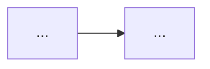

# Formats

## Roadmap

```markdown
# <Product/initiative name>

<one-paragraph goal>

## Success criteria

- ...

## Non-goals

- ...

## Assumptions

1. <assumption> — default: <value>

## Approach

<chosen approach>. Alternatives considered: <one line each>.

## Features

### F1: <outcome-oriented title>

<one-line outcome>. Work item: [items/F1.md](items/F1.md)

**Depends on:** [] | [F2, F3] **Effort:** S|M|L **Risk:** low|standard

## Sequencing

| Wave | Features |
| ---- | -------- |
| 1    | F1, F2   |
| 2    | F3       |

MVP line: through wave <n>.

## Risks

- <risk> — <mitigation or trigger to revisit>

## Out of scope

- ...

## Open questions

- ...
```

## Work item

One file per feature, `docs/product/<slug>/items/F<n>.md`. It is the issue body when filed, and the scope `/arise` runs
against.

````markdown
# F<n>: <short, specific, outcome-oriented title>

## User story

As a <type of user>, I want <capability> so that <benefit>.

<1-2 sentences: the problem this solves and who is affected — the problem, not the solution.>

## Context

<Why now: the success criterion or business goal it serves, customer requests, metrics, related work. Link evidence —
the roadmap, `file:line`, issues — instead of pasting it.>

## Proposed solution

<Optional. High-level expected behavior; a suggestion unless the design is already decided.>



## Acceptance criteria

- [ ] Given <state>, when <action>, then <observable result>.
- [ ] <other testable condition, thresholds as numbers>

## Out of scope

- ...

## Dependencies, risks and open questions

Blocked by F<m>

- Risk: ...
- Open question: ...
````

One `Blocked by F<m>` line per `Depends on:` entry (none when `[]`); filing rewrites each to `Blocked by #<issue>`. Omit
the mermaid block when no diagram helps; write "None." for an empty section rather than dropping its heading.
