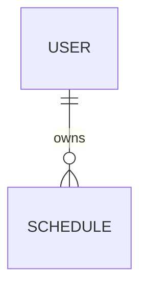
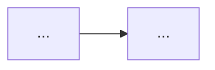

# Formats

## Roadmap (the epic body)

`<state.dir>/roadmaps/<slug>/roadmap.md`. Filed, it becomes the epic's body without its `#` heading.

````markdown
# <Product/initiative name>

<one-paragraph goal>

## Success criteria

- ...

## Non-goals

- ...

## Assumptions

1. <assumption> — default: <value>

## Approach

<chosen approach>. Alternatives considered: <one line each>.

## Data model



### Schedule — created by F1

| Field   | Type | Constraints  |
| ------- | ---- | ------------ |
| id      | uuid | pk           |
| user_id | uuid | fk → User.id |

### User — existing, changed by F2

| Field    | Type | Constraints           |
| -------- | ---- | --------------------- |
| timezone | text | not null, default UTC |

## Features

### F1: <outcome-oriented title>

<one-line outcome>. Data: <entities it creates, changes or reads>. Work item: [items/F1.md](items/F1.md)

**Depends on:** [] | [F2, F3] **Effort:** S|M|L **Risk:** low|standard

## Sequencing

| Wave | Features |
| ---- | -------- |
| 1    | F1, F2   |
| 2    | F3       |

MVP line: through wave <n>.

## Risks

- <risk> — <mitigation or trigger to revisit>

## Out of scope

- ...

## Open questions

- ...
````

## Work item

One file per feature, `<state.dir>/roadmaps/<slug>/items/F<n>.md`. It is the issue body when filed, and the scope
`/solodev-mission` runs against.

````markdown
# F<n>: <short, specific, outcome-oriented title>

## User story

As a <type of user>, I want <capability> so that <benefit>.

<1-2 sentences: the problem this solves and who is affected — the problem, not the solution.>

## Context

<Why now: the success criterion or business goal it serves, customer requests, metrics, related work. Link evidence —
the roadmap, `file:line`, issues — instead of pasting it.>

## Data model

Defined in the roadmap's [Data model](../roadmap.md#data-model). This feature:

- creates `Schedule` (id, user_id, run_at)
- changes `User`: adds `timezone`
- reads `Greeting`

A different shape from the roadmap's is a design decision to raise at the spec gate.

## Proposed solution

<Optional. High-level expected behavior; a suggestion unless the design is already decided.>



## Acceptance criteria

- [ ] Given <state>, when <action>, then <observable result>.
- [ ] <other testable condition, thresholds as numbers>

## Out of scope

- ...

## Dependencies, risks and open questions

Blocked by F<m>

- Risk: ...
- Open question: ...
````

For an `existing` entity, the roadmap's table lists only the fields being added or changed. Write "None: no persisted
data." under the roadmap's Data model when nothing is stored, and drop the Data lines then.

A work item's Data model section names entities and fields only (the tables stay in the roadmap) and states what the
feature touches, not instructions. Omit the whole section when the feature touches no data. Filing rewrites its link to
`the epic, #<epic> › Data model`.

One `Blocked by F<m>` line per `Depends on:` entry (none when `[]`); filing rewrites each to `Blocked by #<issue>`. Omit
the mermaid block when no diagram helps; write "None." for an empty section rather than dropping its heading.
